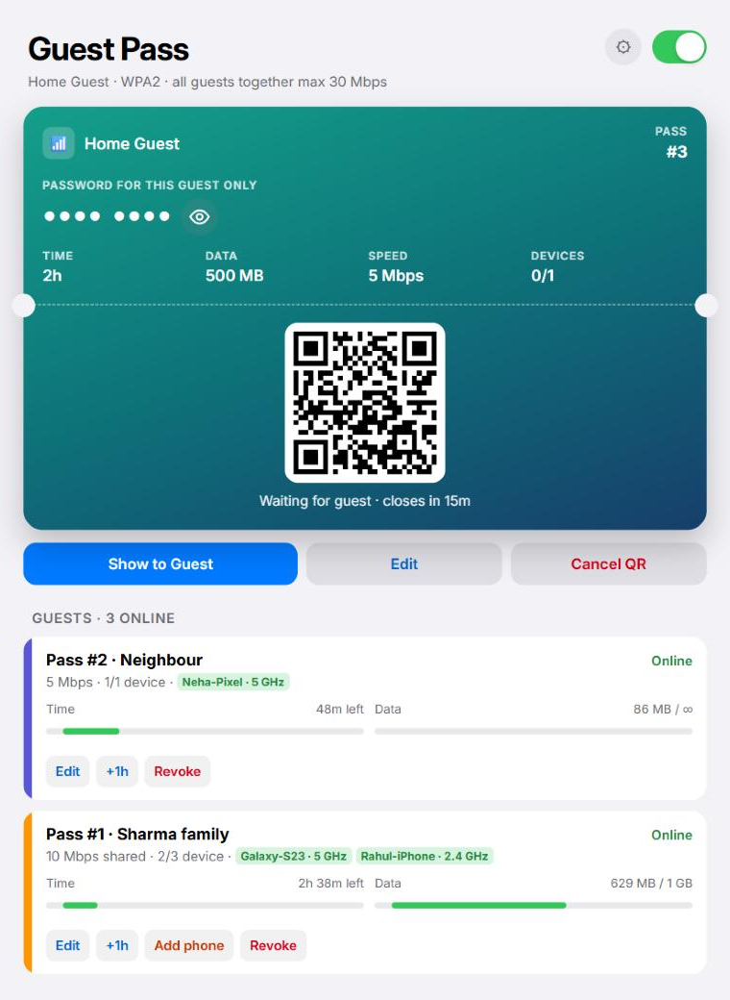
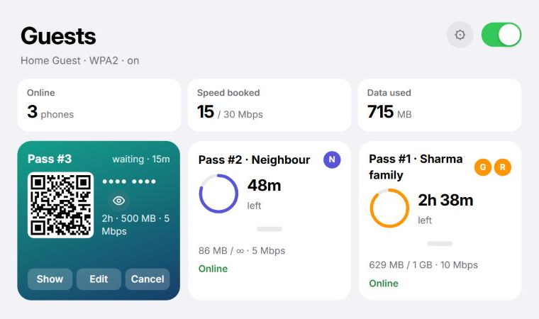

# OpenWrt LuCI extras (JioRouter AX6000 / JIDU6J11)

Four small LuCI pages and a few notes from my home router setup: OpenWrt on a
JioRouter AX6000 (JIDU6J11), with an IPv6-only Jio phone tethered as the uplink.

> [!CAUTION]
> **Use at your own risk.** These were built for my own setup and pulled out of
> it into generic install scripts. The pages run daily on my router (OpenWrt
> SNAPSHOT, apk, kernel 6.18, 4-core ARM, ~430 MB RAM), but **the generic
> installers haven't been tested on a fresh router, so they may fail even on
> the same JIDU6J11.** I can't offer support. Bug reports and fixes are
> welcome as GitHub issues and pull requests.
> Back up first (System → Backup / Flash Firmware → Generate archive), and
> install one page at a time.

> [!NOTE]
> **Disclosure:** I built most of this with help from Claude (Anthropic's AI).
> It wrote most of the scripts and LuCI pages. I did the planning and decided
> what to build, then tested and debugged everything on my own router.

## What's here

| Folder | What it is |
|---|---|
| [`speedtest/`](speedtest) | **Speed Test** page (Services → Speed Test). The router tests its own line to Cloudflare: ping, jitter, download and upload, for IPv4 and IPv6 separately, with live graphs and a history. Shows the CLAT (tayga) CPU load if you run one. |
| [`device-usage/`](device-usage) | **Device Usage** page (Services → Device Usage). Wi-Fi download/upload per device, minute by minute (median, 95th percentile, peak, MB used), plus optional per-device **download speed limits** (HTB on the access points). |
| [`guest-wifi/`](guest-wifi) | **Guest Wi-Fi** "Guest Pass" page (Services → Guest Wi-Fi), v2. **One QR per guest**: each pass has its own password, time, data and speed limit, and the phones that join it are bound to it by MAC, so guests never share each other's limits. Edit, +1 h, revoke or cancel a pass any time; nobody else gets disconnected. Two page styles (Wallet / Dashboard) to pick in Settings. `setup.sh` creates the isolated guest network if you don't have one. |
| [`health/`](health) | **Health** page (Services → Health). RAM, CPU per core, CLAT (tayga) load if you run one, temperature, flash and `/tmp`, with 24 h graphs and a daily summary for a year. It also watches the services you list and shows when each one last stopped. |
| [`nft-snippets/`](nft-snippets) | `30-dns-hijack.nft`: forces all LAN devices' plain DNS (IPv4 and IPv6) to the router's resolver. |
| [`docs/`](docs) | [`clat-ipv6-only-uplink.md`](docs/clat-ipv6-only-uplink.md): how to get fast IPv4 over an IPv6-only phone uplink with a router-side CLAT (tayga). |

## Install a page

Copy the folder to the router and run its installer:

```sh
# from your PC
scp -O -r speedtest root@192.168.1.1:/tmp/
# on the router
sh /tmp/speedtest/install.sh
```

Do the same for `device-usage`, `guest-wifi` and `health`. Then reload LuCI: the page is under **Services**.

Installers copy the files, restart `rpcd`, clear the LuCI cache and add the files
to `/etc/sysupgrade.conf`. `device-usage` and `health` also add a once-a-minute cron job.

### Requirements

- **Speed Test**: `curl`, nftables (fw4, the default since OpenWrt 22.03). It uses
  ~10 MB of RAM in `/tmp` while running, and its own data (each test downloads
  and uploads a few hundred MB on a fast line, so watch metered data).
- **Device Usage**: `iw`. Speed limits also need `tc` (`tc-tiny`) and
  `kmod-sched-core`. It only sees **Wi-Fi** devices (it reads the access points'
  per-station counters, which also work with hardware flow offloading).
  History is kept in `/root/devlog.csv` and written to flash once an hour.

- **Guest Wi-Fi**: `tc-tiny`, `kmod-sched-core`, `kmod-ifb` (the installer checks),
  and a recent OpenWrt with the ucode hostapd scripts (tested on SNAPSHOT r35553).
  Install with `sh install.sh "My Guest"`. Without a network called `guest`, it
  first runs `setup.sh`, which creates:
  - a `br-guest` bridge on `192.168.2.1/24` with DHCP;
  - one guest AP per radio, client isolation on, off by default;
  - a firewall zone that only allows internet (no LAN, no router access except DHCP/DNS);
  - guest DNS forced to the router.

  Already have a guest network? The page controls every wifi-iface whose
  network is `guest`; each one needs an `ifname` like `guest2g` / `guest5g`
  (the installer sets one if missing).

  <p>
  </p>

  **How it works:**
  - Tap **Next guest**, pick time, data, speed and how many devices, and show
    the QR. The pass gets its own 8-digit password.
  - The first phones that join with that QR are **bound to the pass by MAC**.
    Once the pass is full, or after 15 minutes, the QR stops letting new phones in.
  - Time starts when the first phone joins. When the time or data runs out, the
    pass ends and only its phones are disconnected.
  - **Unlock** (shows when a phone of the pass is offline) opens the QR again
    for a phone whose MAC changed, such as an iPhone with a rotating private
    address. Time and data used are kept.
  - All guests together are capped (30 Mbps by default; `uci set guestwifi.ui.cap=50`).

  **Notes:**
  - The installer switches every guest AP to **WPA2 (psk2)** with
    `wpa_psk_file`, and turns PMF off on them. This is what makes per-guest
    passwords possible without restarting Wi-Fi. With WPA3, every change would
    disconnect all WPA3 guests once, and PMF caused "PSK mismatch" on 2.4 GHz.
  - Your home SSIDs aren't touched: changing a pass only reloads the guest
    password file. Turning guest Wi-Fi on or off reloads Wi-Fi; on my router,
    home devices stayed connected.
  - Time and data are checked once a minute (every 3 s while the page is open),
    so a pass can go a little over: on my router a 200 MB pass at 30 Mbps ended at 202.6 MB.
  - After a reboot, guest Wi-Fi stays off and all passes are gone.
  - Upgrading from v1 (one password for everyone): just run the new `install.sh`.
    It turns v1 off first.
  - If you also run Device Usage, use this repo's latest `devlog.sh`: it leaves the
    guest APs alone, so its speed limits don't clash with the per-pass ones.
  - With a router-side CLAT (see docs), add `iifname "br-guest" oifname "clat" accept`
    to the CLAT forward rules, and the guest subnet to its NAT44 masquerade rule.

- **Health**: nothing extra. One sample a minute takes ~30 ms; the last 24 h stay
  in RAM (`/tmp/health.csv`, ~100 KB), and only state changes and one line a day
  are written to flash (`/root/health.events`, `/root/health-daily.csv`).

  **Services:** the installer writes `/etc/health.services` with what it finds:
  dnsmasq, cron, odhcpd, uhttpd, tayga, and this repo's Device Usage and Guest
  Wi-Fi jobs. Add your own, one per line (the file explains the format):

  ```
  # name|kind|match|max age (s)|label|description|file
  adblock|ps|/usr/bin/adblock|0|Adblock|blocks ads for the LAN
  backup|cron|/root/backup.sh|90000|Nightly backup|backup.sh, 03:00|/tmp/backup.done
  ```

  A daemon (`ps`) is up while a process whose command line contains `match` runs.
  A cron job is up while `file` (default `/var/lock/<name>`) changed within
  `max age` seconds, and off if `match` isn't in the crontab. A service counts as
  stopped after two bad samples in a row.

  **Alerts:** make `/etc/health.hook` executable and it runs on each change with
  `<name> <up|down> <detail> <label>`, for example to send a Telegram message.

## Remove

```sh
sh /tmp/speedtest/uninstall.sh
sh /tmp/device-usage/uninstall.sh
sh /tmp/guest-wifi/uninstall.sh          # add --all to also delete the guest network
sh /tmp/health/uninstall.sh
```

This removes every file, the cron jobs, any speed limits and the history
(for Health also your `/etc/health.services` and `/etc/health.hook`).

## What's *not* here, and why

My router also runs an LED status scheme, an uplink watchdog, a network/battery
logger and phone control over adb. Those are tied to my exact hardware and phone,
and could restart the wrong interfaces on another router, so I'm not sharing them.

## Changelog

See [CHANGELOG.md](CHANGELOG.md).

## License

MIT. See [LICENSE](LICENSE).
